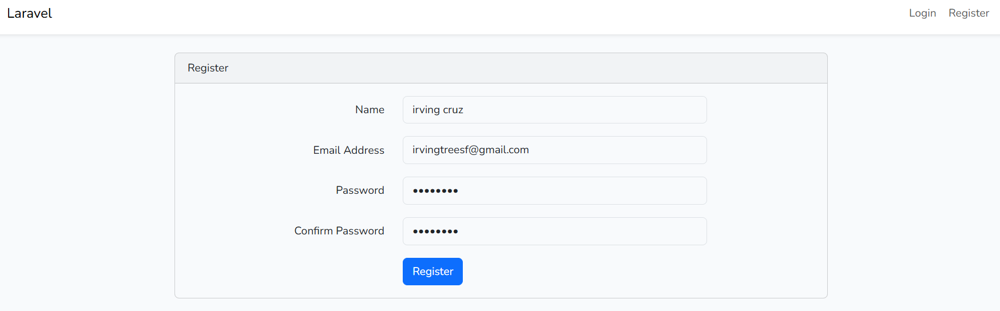
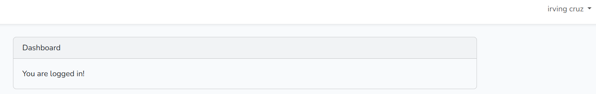
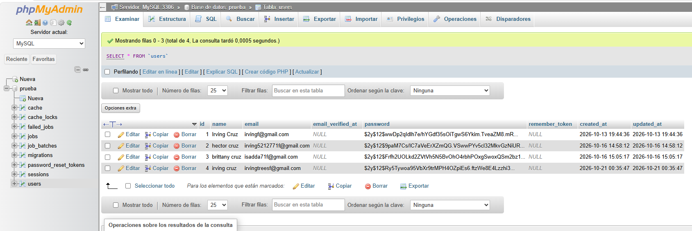
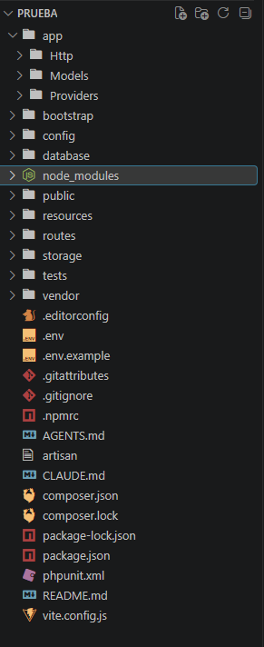

# Laravel Login y Registro (PRUEBA)

## Objetivo

Implementar un sistema de Login y Registro en Laravel utilizando el patrón de arquitectura Modelo-Vista-Controlador (MVC), empleando el paquete `laravel/ui` con Bootstrap para la autenticación y MySQL como base de datos.

---

## Requisitos Previos

| Tecnología | Versión |
|---|---|
| PHP | 8.3 o superior (8.3.28 utilizado) |
| Composer | Última versión estable |
| Laravel | 13.x (v13.36.0 utilizado) |
| WampServer | 64-bit (Apache 2.4.65) |
| MySQL | 8.4.7, incluido en WAMP |
| Visual Studio Code | Recomendado |
| Node.js / NPM | v24.21.0 / 11.19.0, requerido para compilar assets |
| Sistema Operativo | Windows |

---

## Arquitectura MVC en Laravel

| Carpeta | Función |
|---|---|
| `app/Http/Controllers` | Contiene los controladores que manejan la lógica de la aplicación |
| `resources/views` | Contiene las vistas Blade (interfaz de usuario) |
| `app/Models` | Contiene los modelos que interactúan con la base de datos |
| `routes/web.php` | Define las rutas de la aplicación |

Flujo del registro:

```
/register (vista Blade)
   -> RegisterController (app/Http/Controllers/Auth)
   -> Modelo User (app/Models/User.php)
   -> Tabla users (MySQL, base "prueba")
```

---

## Instalación y Configuración

### 1. Ubicarse en la carpeta del servidor

```
cd C:\wamp64\www
```

### 2. Crear el proyecto

```
composer create-project laravel/laravel PRUEBA
```

(Alternativa con el instalador global: `composer global require laravel/installer` y luego `laravel new PRUEBA`).

### 3. Entrar al proyecto

```
cd PRUEBA
```

### 4. Crear la base de datos

En phpMyAdmin crear la base de datos `prueba` con cotejamiento `utf8mb4_unicode_ci`.

### 5. Configurar archivo `.env`

```
DB_CONNECTION=mysql
DB_HOST=127.0.0.1
DB_PORT=3306
DB_DATABASE=prueba
DB_USERNAME=root
DB_PASSWORD=
```

### 6. Configurar el motor InnoDB

En `config/database.php`, dentro del bloque `'mysql'`:

```php
'engine' => 'InnoDB',
```

### 7. Limpiar caché y migrar

```
php artisan config:clear
php artisan migrate
```

La clave de la aplicación (`APP_KEY`) se genera automáticamente al crear el proyecto. Si hiciera falta: `php artisan key:generate`.

### 8. Autenticación (Laravel/UI con Bootstrap)

```
composer require laravel/ui
php artisan ui bootstrap --auth
npm install
npm run dev
```

Esto genera automáticamente las vistas de:

- Login
- Registro
- Recuperación de contraseña
- Dashboard (`/home`)

---

## Base de Datos

Base de datos: `prueba`. Tablas generadas con `php artisan migrate`:

- `users`
- `password_reset_tokens`
- `sessions`
- `cache`
- `cache_locks`
- `jobs`
- `job_batches`
- `failed_jobs`
- `migrations`

---

## Ejecución del proyecto

Antes de iniciar, verificar que WampServer esté en verde (MySQL activo) y que la terminal use PHP 8.3 y Node.js:

```
$env:Path = "C:\wamp64\bin\php\php8.3.28;C:\Program Files\nodejs;" + $env:Path
php -v
```

Levantar servidor, cola y Vite en una sola terminal:

```
composer run dev
```

Alternativa en dos terminales:

```
php artisan serve
npm run dev
```

Acceso: <http://127.0.0.1:8000>

| Ruta | Descripción |
|---|---|
| `/register` | Formulario de registro |
| `/login` | Inicio de sesión |
| `/home` | Dashboard (solo con sesión iniciada) |

---

## Resultado

### Formulario de registro



### Dashboard tras iniciar sesión



### Usuarios guardados en MySQL (phpMyAdmin)



### Estructura del proyecto



---

## Dificultades y Soluciones

### Problema 1: Laravel instalaba la versión 9 y fallaba

Al ejecutar `laravel new PRUEBA` aparecía: `laravel/laravel's latest version requires php ^8.3 which is not satisfied by your platform`. Composer intentaba instalar Laravel 9 y bloqueaba la instalación por avisos de seguridad. La terminal usaba PHP 8.0.30.

**Solución:** Cambiar la versión de PHP en WampServer (PHP > Versión > 8.3.28) y forzarla en la terminal:

```
$env:Path = "C:\wamp64\bin\php\php8.3.28;" + $env:Path
php -v
```

### Problema 2: La terminal volvía a PHP 8.0.30

Al abrir una terminal nueva aparecía el error: `Your Composer dependencies require a PHP version ">= 8.3.0". You are running 8.0.30.`

**Solución:** Repetir el comando de PATH en cada terminal nueva, o dejarlo permanente agregando `C:\wamp64\bin\php\php8.3.28` al inicio del `Path` en las variables de entorno de Windows.

### Problema 3: El comando `laravel` no se reconocía

El instalador global quedaba instalado pero Windows no encontraba el comando.

**Solución:** Crear el proyecto directamente con Composer:

```
composer create-project laravel/laravel PRUEBA
```

### Problema 4: `npm` y `npx` no se reconocían

Al correr `npm install` y `composer run dev` aparecía que `npm` y `npx` no eran comandos válidos, porque Node.js no estaba instalado y luego su ruta no estaba en el PATH de la terminal.

**Solución:** Instalar Node.js (LTS) desde nodejs.org con la opción *Add to PATH* y reiniciar VS Code. Si persiste:

```
$env:Path = "C:\Program Files\nodejs;" + $env:Path
```

### Problema 5: Laravel usaba SQLite en lugar de MySQL

Las primeras migraciones corrieron sobre SQLite y `php artisan migrate` respondía `Nothing to migrate`. Después, `db:show` indicaba `Unknown database 'laravel'`.

**Solución:** En el `.env` cambiar `DB_CONNECTION=sqlite` por `mysql`, descomentar las variables de base de datos y poner `DB_DATABASE=prueba`. Luego:

```
php artisan config:clear
php artisan migrate
```

### Problema 6: Error `Specified key was too long; max key length is 1000 bytes`

Al migrar fallaba la creación de índices en `users` y `failed_jobs`, porque MySQL creaba las tablas con el motor MyISAM.

**Solución:** Configurar el motor InnoDB en `config/database.php` (`'engine' => 'InnoDB'`) y agregar en `AppServiceProvider.php`:

```php
use Illuminate\Support\Facades\Schema;

public function boot(): void
{
    Schema::defaultStringLength(191);
}
```

Después se ejecutó `php artisan migrate:fresh` y las tres migraciones terminaron en DONE.

### Problema 7: phpMyAdmin mostraba 404 en `localhost/phpmyadmin`

La ruta de phpMyAdmin cambia según la versión instalada en WAMP.

**Solución:** Entrar desde el menú de WAMP: *Database management > phpMyAdmin*.

---

## Referencias

- [Laravel Documentation](https://laravel.com/docs/12.x)
- [Laravel/UI Package](https://github.com/laravel/ui)
- [Composer](https://getcomposer.org/)
- [Bootstrap](https://getbootstrap.com/)
- [PHP Official Docs](https://www.php.net/docs.php)

---

## Fecha de Ejecución

20 de Octubre de 2026

| | |
|---|---|
| **Nombre** | Irving Cruz |
| **Curso** | Desarrollo Web |
| **Instructor** | Ing. Irina Fong |